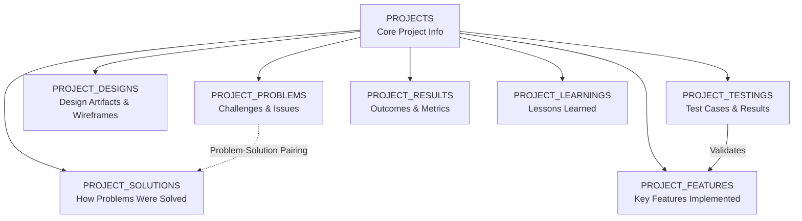

# Design Document: Portfolio Schema Expansion

## Overview

This design expands the portfolio project schema from a simple flat structure to a comprehensive, multi-layered project documentation system. The expansion introduces six new entity tables (PROJECT_PROBLEMS, PROJECT_SOLUTIONS, PROJECT_DESIGNS, PROJECT_FEATURES, PROJECT_TESTINGS, PROJECT_RESULTS, and PROJECT_LEARNINGS) that enable detailed project storytelling including challenges faced, solutions implemented, design artifacts, built features, testing coverage, measurable outcomes, and key learnings. This allows portfolio viewers to understand not just what was built, but the entire development journey and decision-making process.

## Architecture



## Data Model & Relationships

### Core Entity: PROJECTS (Existing)

**Purpose**: Serves as the root aggregator for all project-related information

**Structure**:
```
PROJECTS
├── id (BIGSERIAL PRIMARY KEY)
├── title (TEXT)
├── slug (TEXT UNIQUE)
├── description (TEXT)
├── image_urls (TEXT[] - array of image URLs)
├── demo_url (TEXT nullable)
├── github_url (TEXT nullable)
├── created_at (TIMESTAMP)
└── updated_at (TIMESTAMP)
```

### New Child Entities

#### 1. PROJECT_PROBLEMS
**Purpose**: Capture project challenges, blockers, and problems that needed solving

**Structure**:
```
PROJECT_PROBLEMS
├── id (BIGSERIAL PRIMARY KEY)
├── project_id (BIGINT FOREIGN KEY → projects.id)
├── title (TEXT) - concise problem title
├── description (TEXT) - detailed problem explanation
├── sort_order (INTEGER) - display ordering
├── created_at (TIMESTAMP)
└── updated_at (TIMESTAMP)
```

**Relationships**:
- Many-to-one with PROJECTS
- Can be paired with PROJECT_SOLUTIONS via narrative flow (not enforced in schema)
- Multiple problems per project

#### 2. PROJECT_SOLUTIONS
**Purpose**: Document how each problem was addressed and solved

**Structure**:
```
PROJECT_SOLUTIONS
├── id (BIGSERIAL PRIMARY KEY)
├── project_id (BIGINT FOREIGN KEY → projects.id)
├── title (TEXT) - concise solution title
├── description (TEXT) - technical details of the solution
├── icon (TEXT nullable) - icon identifier for visual representation
├── sort_order (INTEGER) - display ordering
├── created_at (TIMESTAMP)
└── updated_at (TIMESTAMP)
```

**Relationships**:
- Many-to-one with PROJECTS
- Logically corresponds to PROJECT_PROBLEMS (no FK constraint; application logic handles pairing)
- Multiple solutions per project

#### 3. PROJECT_DESIGNS
**Purpose**: Store design mockups, wireframes, prototypes, and visual design artifacts

**Structure**:
```
PROJECT_DESIGNS
├── id (BIGSERIAL PRIMARY KEY)
├── project_id (BIGINT FOREIGN KEY → projects.id)
├── type (TEXT) - design artifact type (e.g., 'wireframe', 'mockup', 'prototype', 'uml', 'flowchart')
├── title (TEXT) - design artifact title
├── description (TEXT) - context about the design
├── image_url (TEXT) - URL to the design image/file
├── sort_order (INTEGER) - display ordering
├── created_at (TIMESTAMP)
└── updated_at (TIMESTAMP)
```

**Relationships**:
- Many-to-one with PROJECTS
- No direct relationship to other entities
- Multiple design artifacts per project

#### 4. PROJECT_FEATURES
**Purpose**: Enumerate key features built in the project with descriptions

**Structure**:
```
PROJECT_FEATURES
├── id (BIGSERIAL PRIMARY KEY)
├── project_id (BIGINT FOREIGN KEY → projects.id)
├── title (TEXT) - feature name
├── description (TEXT) - feature description and functionality
├── image_url (TEXT nullable) - screenshot or feature demo image
├── sort_order (INTEGER) - display ordering
├── created_at (TIMESTAMP)
└── updated_at (TIMESTAMP)
```

**Relationships**:
- Many-to-one with PROJECTS
- Logically tested by PROJECT_TESTINGS (via application logic, not schema FK)
- Multiple features per project

#### 5. PROJECT_TESTINGS
**Purpose**: Document test cases, expected vs actual results, and test status

**Structure**:
```
PROJECT_TESTINGS
├── id (BIGSERIAL PRIMARY KEY)
├── project_id (BIGINT FOREIGN KEY → projects.id)
├── test_case (TEXT) - description of what is being tested
├── expected_result (TEXT) - what should happen
├── actual_result (TEXT) - what actually happened
├── status (TEXT) - test status ('passed', 'failed', 'pending', 'skipped')
├── sort_order (INTEGER) - display ordering
├── created_at (TIMESTAMP)
└── updated_at (TIMESTAMP)
```

**Relationships**:
- Many-to-one with PROJECTS
- Implicitly validates PROJECT_FEATURES (no schema FK)
- Multiple test cases per project

#### 6. PROJECT_RESULTS
**Purpose**: Capture measurable outcomes, metrics, and project impact

**Structure**:
```
PROJECT_RESULTS
├── id (BIGSERIAL PRIMARY KEY)
├── project_id (BIGINT FOREIGN KEY → projects.id)
├── title (TEXT) - result/outcome title
├── description (TEXT) - detailed description of the result
├── metric_value (TEXT) - the actual metric value (e.g., "95%", "2.5x", "1000+")
├── metric_label (TEXT) - unit or label for the metric (e.g., "accuracy", "improvement", "users")
├── sort_order (INTEGER) - display ordering
├── created_at (TIMESTAMP)
└── updated_at (TIMESTAMP)
```

**Relationships**:
- Many-to-one with PROJECTS
- No relationships to other child entities
- Multiple results per project

#### 7. PROJECT_LEARNINGS
**Purpose**: Document lessons learned during the project

**Structure**:
```
PROJECT_LEARNINGS
├── id (BIGSERIAL PRIMARY KEY)
├── project_id (BIGINT FOREIGN KEY → projects.id)
├── content (TEXT) - the lesson or learning
├── sort_order (INTEGER) - display ordering
├── created_at (TIMESTAMP)
└── updated_at (TIMESTAMP)
```

**Relationships**:
- Many-to-one with PROJECTS
- Simplest entity; no relationships to other child entities
- Multiple learnings per project

## Database Design Patterns

### Ordering & Sorting
All child entities use a `sort_order` INTEGER field to control display sequence without requiring data reordering. This follows the portfolio's existing pattern seen in the skills and educations tables.

### Foreign Key Strategy
- All child entities use BIGINT FOREIGN KEY to projects.id with CASCADE DELETE
- Cascade delete ensures orphaned records don't accumulate if a project is deleted
- No explicit cross-entity foreign keys (e.g., problems to solutions) to maintain flexibility

### Timestamps
- All entities include `created_at` (auto-set) and `updated_at` (auto-updated via trigger)
- Supports audit trails and sorting by creation/modification time

### Row Level Security (RLS)
- All child entities follow the same RLS pattern as projects table
- Public read access for all data
- Authenticated-only write/update/delete operations

### Indexing Strategy
```
- project_id on all child tables (for efficient lookups by project)
- created_at on all child tables (for sorting/filtering)
- Composite index (project_id, sort_order) for ordered queries
```

## Type System Architecture

### TypeScript Structure

New types will extend the existing portfolio system:

```typescript
// Individual entity types
type ProjectProblem = {
  id: number;
  project_id: number;
  title: string;
  description: string;
  sort_order: number;
  created_at: string;
  updated_at: string;
}

type ProjectSolution = {
  id: number;
  project_id: number;
  title: string;
  description: string;
  icon: string | null;
  sort_order: number;
  created_at: string;
  updated_at: string;
}

type ProjectDesign = {
  id: number;
  project_id: number;
  type: 'wireframe' | 'mockup' | 'prototype' | 'uml' | 'flowchart' | string;
  title: string;
  description: string;
  image_url: string;
  sort_order: number;
  created_at: string;
  updated_at: string;
}

type ProjectFeature = {
  id: number;
  project_id: number;
  title: string;
  description: string;
  image_url: string | null;
  sort_order: number;
  created_at: string;
  updated_at: string;
}

type ProjectTesting = {
  id: number;
  project_id: number;
  test_case: string;
  expected_result: string;
  actual_result: string;
  status: 'passed' | 'failed' | 'pending' | 'skipped';
  sort_order: number;
  created_at: string;
  updated_at: string;
}

type ProjectResult = {
  id: number;
  project_id: number;
  title: string;
  description: string;
  metric_value: string;
  metric_label: string;
  sort_order: number;
  created_at: string;
  updated_at: string;
}

type ProjectLearning = {
  id: number;
  project_id: number;
  content: string;
  sort_order: number;
  created_at: string;
  updated_at: string;
}

// Enriched project type
type ProjectWithDetails = Project & {
  problems: ProjectProblem[];
  solutions: ProjectSolution[];
  designs: ProjectDesign[];
  features: ProjectFeature[];
  testings: ProjectTesting[];
  results: ProjectResult[];
  learnings: ProjectLearning[];
}
```

## CRUD Operations Architecture

### Core Operations Pattern
Each entity will support:
- **Create**: INSERT with validation
- **Read**: Fetch by project_id (ordered by sort_order)
- **Update**: Modify existing records with updated_at trigger
- **Delete**: Remove individual records or cascade from project
- **Reorder**: Batch update sort_order for display sequence changes

### Server Action Pattern
All database operations will be implemented as server actions in `src/lib/actions/portfolio.ts` following Next.js patterns:

```typescript
// Creation actions
createProjectProblem(projectId, data)
createProjectSolution(projectId, data)
createProjectDesign(projectId, data)
createProjectFeature(projectId, data)
createProjectTesting(projectId, data)
createProjectResult(projectId, data)
createProjectLearning(projectId, data)

// Deletion actions
deleteProjectProblem(id)
deleteProjectSolution(id)
deleteProjectDesign(id)
deleteProjectFeature(id)
deleteProjectTesting(id)
deleteProjectResult(id)
deleteProjectLearning(id)

// Update actions
updateProjectProblem(id, data)
updateProjectSolution(id, data)
updateProjectDesign(id, data)
updateProjectFeature(id, data)
updateProjectTesting(id, data)
updateProjectResult(id, data)
updateProjectLearning(id, data)

// Reordering actions
reorderProjectProblem(projectId, items)
reorderProjectSolution(projectId, items)
reorderProjectDesign(projectId, items)
reorderProjectFeature(projectId, items)
reorderProjectTesting(projectId, items)
reorderProjectResult(projectId, items)
reorderProjectLearning(projectId, items)

// Fetch actions
getProjectDetails(projectId) // returns ProjectWithDetails
```

## React Hooks Architecture

Custom hooks will provide component-level data access:

```typescript
// usePortfolio.ts hooks

// Individual entity hooks
useProjectProblems(projectId)
useProjectSolutions(projectId)
useProjectDesigns(projectId)
useProjectFeatures(projectId)
useProjectTestings(projectId)
useProjectResults(projectId)
useProjectLearnings(projectId)

// Combined hook for full project details
useProjectWithDetails(projectId)

// Management hooks (with loading/error states)
useCreateProjectProblem()
useUpdateProjectProblem()
useDeleteProjectProblem()
// ... similar for all entities
```

Each hook will handle:
- Data fetching and caching
- Loading and error states
- Real-time updates via Supabase subscriptions (optional)
- Optimistic UI updates

## Admin UI Architecture

### ProjectsClient.tsx Enhancement

The admin interface will be extended with:

1. **Tabbed Interface**: Separate tabs for each entity type
   - Overview (Projects list)
   - Problems
   - Solutions
   - Designs
   - Features
   - Testing
   - Results
   - Learnings

2. **CRUD Forms**: For each entity type:
   - Create modal/form
   - Edit modal/form
   - Delete confirmation
   - Bulk reorder interface

3. **Drag-and-Drop Reordering**: For sort_order management

4. **Rich Text Editing**: For description fields (optional enhancement)

5. **Image Upload**: Integration with Supabase storage for design and feature images

## Implementation Phases

### Phase 1: Database Migrations
- Create 7 new tables with proper relationships
- Add appropriate indexes and constraints
- Set up RLS policies
- Add update_updated_at triggers

### Phase 2: TypeScript Type Definitions
- Add all new entity types to `src/types/portfolio.ts`
- Create union types for comprehensive project data
- Add enums for fixed-value fields (design type, test status)

### Phase 3: Server Actions
- Implement CRUD operations in `src/lib/actions/portfolio.ts`
- Add validation and error handling
- Implement reordering logic
- Add batch operations where applicable

### Phase 4: React Hooks
- Create custom hooks in `src/hooks/usePortfolio.ts`
- Implement loading/error state management
- Add Supabase subscription support (optional)

### Phase 5: Admin UI
- Update `src/app/admin/projects/ProjectsClient.tsx`
- Create reusable form components for each entity
- Implement tabbed navigation
- Add CRUD UI for each entity type

## Key Design Decisions

1. **No Explicit Linking Between Entities**: Problems and Solutions are logically related but not enforced via foreign keys, allowing flexibility in how they're displayed and paired.

2. **sort_order vs Hard Timestamps**: Using integer sort_order for UI ordering instead of creation order, enabling manual curation and resequencing without data mutation.

3. **Cascade Delete from Projects**: Child entities are automatically deleted when a project is deleted, preventing orphaned data and simplifying deletion logic.

4. **Flexible Field Types**: Design type and test status use TEXT with application-level enums, allowing future expansion without schema migration.

5. **Nullable Image URLs**: Features and designs can have optional images, supporting text-only documentation if needed.

6. **Public Read, Authenticated Write**: Following existing portfolio pattern—data is publicly viewable but only authenticated users can modify.

## Correctness Properties

### Property 1: Referential Integrity
*For all* child entity records, the project_id should reference an existing project record in the PROJECTS table, and deleting a project should cascade-delete all associated child records.

**Validates: Requirements 1.1, 2.1**

### Property 2: Ordering Preservation
*For any* project's child entities, querying with ORDER BY sort_order should return records in the order specified by their sort_order values without gaps or inconsistencies.

**Validates: Requirements 3.1**

### Property 3: Timestamp Consistency
*For all* entity records, the created_at timestamp should be immutable after creation, and updated_at should always reflect the most recent modification time, being >= created_at.

**Validates: Requirements 2.2**

### Property 4: Data Isolation
*For any* user accessing project details, they should only see entities belonging to the requested project_id, with no cross-project data leakage.

**Validates: Requirements 1.2**

### Property 5: Status Validity
*For all* ProjectTesting records, the status field should contain only valid values ('passed', 'failed', 'pending', 'skipped') as enforced by application validation.

**Validates: Requirements 5.1**

