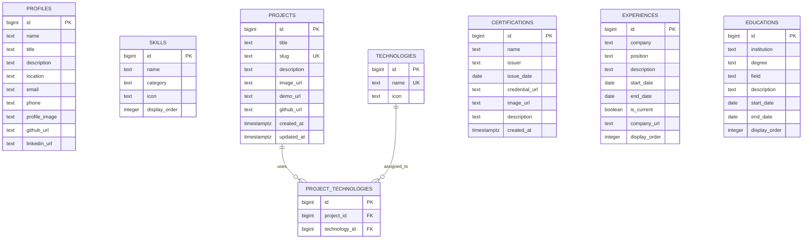

# ERD --- Portfolio Website

## 1. Gambaran Database

Database menggunakan **Supabase PostgreSQL** untuk menyimpan seluruh
data yang digunakan oleh website portfolio.

Entitas utama:

-   `profiles`
-   `skills`
-   `projects`
-   `technologies`
-   `project_technologies`
-   `certifications`
-   `educations`

File gambar tidak disimpan di PostgreSQL. Gambar disimpan di **Supabase
Storage**, sedangkan database menyimpan URL/path gambar.

------------------------------------------------------------------------

## 2. Entity Relationship Diagram

``` text
┌─────────────────────┐
│      profiles       │
├─────────────────────┤
│ PK id               │
│    name             │
│    title            │
│    description      │
│    location         │
│    email            │
│    phone            │
│    profile_image    │───────┐
│    github_url       │       │
│    linkedin_url     │       │
└─────────────────────┘       │
                              │
                              │ URL / Path
                              ▼
                       Supabase Storage


┌─────────────────────┐
│       skills        │
├─────────────────────┤
│ PK id               │
│    name             │
│    category         │
│    icon              │
│    display_order    │
└─────────────────────┘


┌─────────────────────┐
│      projects       │
├─────────────────────┤
│ PK id               │
│    title            │
│    slug             │
│    description      │
│    image_url        │───────┐
│    demo_url         │       │
│    github_url       │       │
│    created_at       │       │
│    updated_at       │       │
└──────────┬──────────┘       │
           │                  │
           │ 1                │ URL / Path
           │                  ▼
           │           Supabase Storage
           │
           │ N
           ▼
┌─────────────────────────────┐
│    project_technologies     │
├─────────────────────────────┤
│ PK id                       │
│ FK project_id               │
│ FK technology_id            │
└──────────────┬──────────────┘
               │
               │ N
               ▼
      ┌─────────────────────┐
      │    technologies     │
      ├─────────────────────┤
      │ PK id               │
      │    name             │
      │    icon             │
      └─────────────────────┘


┌─────────────────────────┐
│    certifications       │
├─────────────────────────┤
│ PK id                   │
│    name                 │
│    issuer               │
│    issue_date           │
│    credential_url       │
│    image_url             │───────┐
│    description          │       │
│    created_at           │       │
└─────────────────────────┘       │
                                  │ URL / Path
                                  ▼
                           Supabase Storage


┌─────────────────────────┐
│       educations        │
├─────────────────────────┤
│ PK id                   │
│    institution          │
│    degree               │
│    field                │
│    description          │
│    start_date            │
│    end_date              │
│    display_order         │
└─────────────────────────┘
```

------------------------------------------------------------------------

## 3. Relasi Antar Entitas

### Projects --- Technologies

Relasi:

``` text
projects
    │
    │ 1 : N
    ▼
project_technologies
    ▲
    │ N : 1
    │
technologies
```

Secara konseptual:

``` text
Project ←──────→ Technology
        M : N
```

Satu project dapat menggunakan banyak teknologi.

Contoh:

``` text
Raih Prestasi
├── Next.js
├── Prisma
├── PostgreSQL
└── Flutter
```

Satu teknologi juga dapat digunakan oleh banyak project.

Contoh:

``` text
Next.js
├── Raih Prestasi
├── Portfolio
└── Project XYZ
```

Karena PostgreSQL tidak memiliki relasi many-to-many langsung, digunakan
tabel penghubung `project_technologies`.

------------------------------------------------------------------------

## 4. Struktur Tabel

### 4.1 `profiles`

Menyimpan informasi utama pemilik portfolio.

  Field             Type     Constraint   Description
  ----------------- -------- ------------ --------------------
  `id`              bigint   PK           ID profile
  `name`            text     NOT NULL     Nama
  `title`           text     NOT NULL     Professional title
  `description`     text                  Deskripsi
  `location`        text                  Lokasi
  `email`           text                  Email
  `phone`           text                  Nomor telepon
  `profile_image`   text                  URL/path foto
  `github_url`      text                  URL GitHub
  `linkedin_url`    text                  URL LinkedIn

Untuk portfolio pribadi, tabel ini biasanya hanya memiliki satu record.

------------------------------------------------------------------------

### 4.2 `skills`

Menyimpan daftar skill yang dimiliki.

  Field             Type      Constraint   Description
  ----------------- --------- ------------ -----------------
  `id`              bigint    PK           ID skill
  `name`            text      NOT NULL     Nama skill
  `category`        text      NOT NULL     Kategori
  `icon`            text                   Icon
  `display_order`   integer                Urutan tampilan

Contoh:

``` text
Frontend
├── Next.js
├── React
└── Tailwind CSS

Backend
├── Laravel
├── Express.js
└── Node.js

Database
├── PostgreSQL
├── MySQL
└── Prisma
```

------------------------------------------------------------------------

### 4.3 `projects`

Menyimpan project portfolio.

  Field           Type          Constraint   Description
  --------------- ------------- ------------ ------------------
  `id`            bigint        PK           ID project
  `title`         text          NOT NULL     Nama project
  `slug`          text          UNIQUE       URL slug
  `description`   text                       Deskripsi
  `image_url`     text                       URL gambar
  `demo_url`      text                       URL demo
  `github_url`    text                       URL repository
  `created_at`    timestamptz                Waktu dibuat
  `updated_at`    timestamptz                Waktu diperbarui

Contoh:

``` text
id: 1
title: Raih Prestasi
slug: raih-prestasi
description: Sistem informasi prestasi siswa
image_url: https://...supabase.co/storage/...
demo_url: https://...
github_url: https://github.com/...
```

------------------------------------------------------------------------

### 4.4 `technologies`

Menyimpan master data teknologi.

  Field    Type     Constraint   Description
  -------- -------- ------------ ----------------
  `id`     bigint   PK           ID teknologi
  `name`   text     UNIQUE       Nama teknologi
  `icon`   text                  Icon teknologi

Contoh:

``` text
1 | Next.js
2 | React
3 | Laravel
4 | Flutter
5 | Prisma
6 | PostgreSQL
```

------------------------------------------------------------------------

### 4.5 `project_technologies`

Tabel penghubung antara project dan teknologi.

  Field             Type     Constraint   Description
  ----------------- -------- ------------ --------------
  `id`              bigint   PK           ID
  `project_id`      bigint   FK           ID project
  `technology_id`   bigint   FK           ID teknologi

Foreign key:

``` text
project_id
    ↓
projects.id

technology_id
    ↓
technologies.id
```

Disarankan membuat kombinasi:

``` text
UNIQUE(project_id, technology_id)
```

agar teknologi yang sama tidak terhubung dua kali ke project yang sama.

------------------------------------------------------------------------

### 4.6 `certifications`

Menyimpan sertifikasi keahlian.

  Field              Type          Constraint   Description
  ------------------ ------------- ------------ ------------------
  `id`               bigint        PK           ID sertifikat
  `name`             text          NOT NULL     Nama sertifikasi
  `issuer`           text          NOT NULL     Penerbit
  `issue_date`       date                       Tanggal terbit
  `credential_url`   text                       URL credential
  `image_url`        text                       URL gambar
  `description`      text                       Deskripsi
  `created_at`       timestamptz                Waktu dibuat

Gambar sertifikat berada di:

``` text
Supabase Storage
└── portfolio/
    └── certifications/
```

------------------------------------------------------------------------

### 4.7 `experiences`

Menyimpan pengalaman kerja, freelance, internship, atau pengalaman
relevan lainnya.

  Field             Type      Constraint      Description
  ----------------- --------- --------------- ----------------------------
  `id`              bigint    PK              ID experience
  `company`         text      NOT NULL        Nama perusahaan/organisasi
  `position`        text      NOT NULL        Posisi
  `description`     text                      Deskripsi
  `start_date`      date                      Tanggal mulai
  `end_date`        date                      Tanggal selesai
  `is_current`      boolean   DEFAULT false   Masih aktif
  `company_url`     text                      URL perusahaan
  `display_order`   integer                   Urutan tampilan

Jika `is_current = true`, `end_date` dapat bernilai `NULL`.

------------------------------------------------------------------------

### 4.8 `educations`

Menyimpan riwayat pendidikan.

  Field             Type      Constraint   Description
  ----------------- --------- ------------ -----------------
  `id`              bigint    PK           ID education
  `institution`     text      NOT NULL     Institusi
  `degree`          text                   Jenjang
  `field`           text                   Program studi
  `description`     text                   Deskripsi
  `start_date`      date                   Tanggal mulai
  `end_date`        date                   Tanggal selesai
  `display_order`   integer                Urutan tampilan

Contoh:

``` text
Politeknik Negeri Malang
D3 Manajemen Informatika
2023 — 2026
```

------------------------------------------------------------------------

## 5. ERD Mermaid

Diagram berikut dapat dirender oleh GitHub, GitLab, Obsidian, dan
beberapa Markdown editor yang mendukung Mermaid.



------------------------------------------------------------------------

## 6. Storage Relationship

Supabase Storage bukan tabel relational biasa, sehingga hubungan file
dengan database direpresentasikan melalui URL/path.

``` text
┌─────────────────────┐
│ PostgreSQL          │
│                     │
│ projects            │
│ image_url           │─────────────┐
└─────────────────────┘             │
                                    │
                                    ▼
                         ┌─────────────────────┐
                         │ Supabase Storage    │
                         │                     │
                         │ portfolio/          │
                         │ └── projects/       │
                         │     └── image.webp  │
                         └─────────────────────┘
```

Hal yang sama berlaku untuk:

``` text
profiles.profile_image
certifications.image_url
projects.image_url
```

------------------------------------------------------------------------

## 7. Rekomendasi Constraint

Beberapa constraint yang disarankan:

``` sql
-- Project slug harus unik
UNIQUE(slug)

-- Nama teknologi harus unik
UNIQUE(name)

-- Satu teknologi tidak boleh terhubung
-- dua kali ke project yang sama
UNIQUE(project_id, technology_id)
```

Untuk foreign key:

``` sql
project_technologies.project_id
    REFERENCES projects(id)
    ON DELETE CASCADE

project_technologies.technology_id
    REFERENCES technologies(id)
    ON DELETE CASCADE
```

Dengan `ON DELETE CASCADE`, ketika project dihapus, relasi pada
`project_technologies` ikut dihapus.

------------------------------------------------------------------------

## 8. Catatan Arsitektur

Database ini sengaja dibuat relatif sederhana karena sistem merupakan
**personal portfolio**, bukan aplikasi dengan banyak pengguna dan
transaksi kompleks.

Tidak semua data perlu dibuat menjadi tabel yang saling berelasi. Data
seperti `skills`, `experiences`, `educations`, dan `certifications`
dapat berdiri sendiri.

Relasi yang benar-benar diperlukan adalah:

``` text
Projects ←→ Technologies
```

karena satu project dapat menggunakan banyak teknologi dan satu
teknologi dapat digunakan oleh banyak project.

Sedangkan file gambar dikelola oleh **Supabase Storage**, bukan
PostgreSQL.
